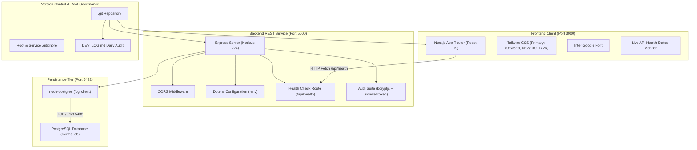
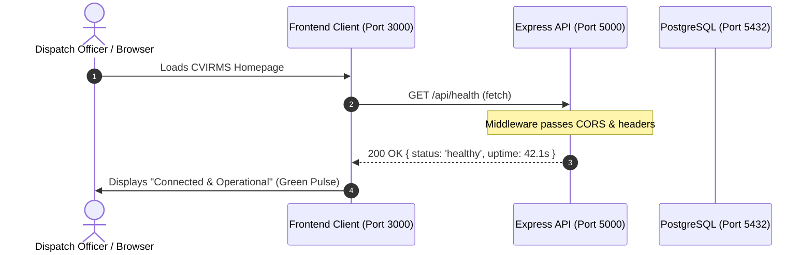

# CVIRMS - Day 1 Architecture & Setup Documentation
**Centralized Vehicle Identification & Records Management System**  
**Document Version:** 1.0.0  
**Date:** October 12, 2026  

---

## 1. Executive Summary

CVIRMS (Centralized Vehicle Identification & Records Management System) is an enterprise-grade platform architected to modernize law enforcement vehicle tracking, civil registration lookup, and real-time incident verification.

Day 1 establishes the foundational full-stack architecture:
1. **Developer Audit & Changelog System (`DEV_LOG.md`):** Institutional memory tracking development velocity and daily architectural commits.
2. **Backend REST API Engine (`cvirms-backend`):** High-throughput Node.js & Express server equipped with security headers, PostgreSQL driver configuration, and system health telemetry.
3. **Frontend Application (`cvirms-frontend`):** Next.js 16 App Router interface powered by TypeScript, Tailwind CSS, Google Inter typography, and CVIRMS brand colors (Sky Blue `#0EA5E9` and Dark Navy `#0F172A`).
4. **Unified Multi-Tier Repository Integration:** Root-level Git versioning and multi-tier `.gitignore` safeguarding secrets and production artifacts.

---

## 2. High-Level System Architecture

The following diagram illustrates the multi-tier architecture, network boundaries, and port assignments across local development:



---

## 3. Directory & File Organization

The project adopts a structured multi-folder monorepo pattern that isolates frontend and backend concerns while allowing unified git tracking:

```
cvirms app/
├── DEV_LOG.md                     # Daily development changelog
├── DAY_1_DOCUMENTATION.md         # Architecture, explanation & diagram guide
├── .gitignore                     # Monorepo-level ignore rules
├── cvirms-backend/                # Node.js + Express REST API
│   ├── .env                       # Local secrets & DB connection strings
│   ├── .env.example               # Sanitized template for environment variables
│   ├── .gitignore                 # Backend-specific ignore rules
│   ├── package.json               # Backend dependencies & npm scripts
│   └── server.js                  # Express application & /api/health endpoint
└── cvirms-frontend/               # Next.js 16 App Router Client
    ├── app/
    │   ├── globals.css            # Tailwind theme tokens & color variables
    │   ├── layout.tsx             # Root layout with Inter font & metadata
    │   └── page.tsx               # Homepage placeholder & live API monitor
    ├── public/                    # Static assets & icons
    ├── tailwind.config.ts         # Tailwind design system configuration
    ├── tsconfig.json              # TypeScript compilation settings
    ├── eslint.config.mjs          # ESLint linting rules
    └── package.json               # Next.js dependencies & scripts
```

---

## 4. Detailed Task-by-Task Explanation

### Task 1: Project Log File (`DEV_LOG.md`)
* **Objective:** Establish a persistent daily development ledger to maintain agile accountability.
* **Mechanism:** Documents the technical accomplishments, architectural decisions, and integration status achieved at the close of every day.
* **Format:**
  ```markdown
  # CVIRMS Development Log
  ## Day 1 - October 12, 2026
  **Backend:** Initialized Node.js/Express setup.
  **Frontend:** Initialized Next.js + Tailwind with CVIRMS colors.
  **Integration:** Git initialized, .gitignore created, ready to push.
  *(We will update this file at the end of every day).*
  ```

---

### Task 2: Backend REST Engine Setup (`cvirms-backend`)
* **Objective:** Construct the foundational Node.js/Express server that will handle authentication, vehicle registration data, and database querying.
* **Key Components:**
  1. **Dependencies:**
     * `express`: Fast, unopinionated web framework for routing.
     * `cors`: Cross-Origin Resource Sharing middleware enabling `cvirms-frontend` (Port 3000) to communicate with the API (Port 5000).
     * `dotenv`: Loads environment configurations from `.env`.
     * `pg`: Official PostgreSQL client for relational querying and connection pooling.
     * `bcryptjs`: Industry-standard password hashing algorithm for officer/admin credentials.
     * `jsonwebtoken`: Stateless token generation for secure API authorization.
     * `nodemon` (dev): Auto-restarts server upon file modifications.
  2. **Health Check Endpoint (`/api/health`):**
     * Returns HTTP 200 with JSON payload (`status`, `timestamp`, `uptime`, `environment`).
     * Serves as the heartbeat for DevOps monitoring and frontend connection validation.
  3. **Environment Security (`.env` & `.gitignore`):**
     * Prevents database credentials (`DB_PASSWORD`) and `JWT_SECRET` from leaking into Git.
     * Provides `.env.example` as a clean onboarding template.
  4. **NPM Scripts:**
     * `npm start`: Runs `node server.js` (production-ready).
     * `npm run dev`: Runs `nodemon server.js` (development with hot-reload).

---

### Task 3: Frontend Client Setup (`cvirms-frontend`)
* **Objective:** Scaffold a modern, responsive web application for law enforcement officers, dispatch operators, and administrators.
* **Key Components:**
  1. **Next.js 16 App Router & React 19:**
     * High-speed server and client component rendering.
     * Strict TypeScript typing for robust development.
  2. **Brand Design System:**
     * **Primary Sky Blue (`#0EA5E9`):** Represents precision, intelligence, and modern public safety tech.
     * **Dark Navy (`#0F172A`):** Represents authority, high contrast, security, and legibility.
     * Both colors configured via `tailwind.config.ts` and Tailwind CSS `@theme` tokens in `app/globals.css`.
  3. **Typography:**
     * Next.js Google Font `Inter` applied directly in `app/layout.tsx` to provide crisp typography.
  4. **Interactive Homepage (`app/page.tsx`):**
     * Features the official placeholder:  
       **"CVIRMS - Smarter Records. Safer City."**
     * Includes a live client-side API health ping button that tests real-time connectivity to `http://localhost:5000/api/health`.

---

### Task 4: Integration & Source Control
* **Objective:** Establish version control repository hygiene so frontend, backend, and documentation can be maintained in a unified repository.
* **Root `.gitignore` Strategy:**
  * Excludes `node_modules/` across all levels to avoid committing gigabytes of third-party code.
  * Excludes `.env*` across all subdirectories to protect secrets.
  * Excludes `.next/`, `dist/`, and `build/` compilation artifacts.

---

## 5. API Health Check Sequence Diagram



---

## 6. Daily Execution & Verification Guide

### To run the Backend:
```bash
cd cvirms-backend
npm run dev
# Server will run on: http://localhost:5000
# Health Check endpoint: http://localhost:5000/api/health
```

### To run the Frontend:
```bash
cd cvirms-frontend
npm run dev
# Frontend will run on: http://localhost:3000
```

### To test the Health Check via PowerShell:
```powershell
Invoke-RestMethod -Uri http://localhost:5000/api/health
```
