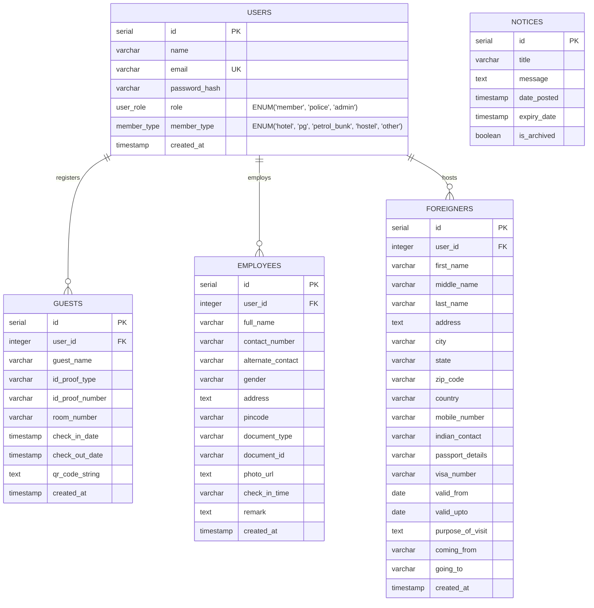

# CVIRMS - Day 2 Architecture & Implementation Guide
**City Visitor Information and Record Management System**  
**Document Version:** 2.0.0  
**Date:** October 12, 2026  
**Focus:** PostgreSQL Schema Architecture & High-Fidelity Landing Page (Navbar + Hero)

---

## 1. Executive Summary

Day 2 advances the CVIRMS platform from foundational scaffolding into a connected, database-backed enterprise application with a pixel-perfect, government-grade landing interface.

### Key Milestones Achieved:
1. **Relational Database Tier:** Configured connection pooling in `db.js` using `pg.Pool`, connecting securely to the `cvirms` PostgreSQL database. Designed and executed `schema.sql` creating 5 mission-critical tables with relational constraints, custom ENUM types, and indexing.
2. **Database Verification Route:** Added `GET /api/db-test` returning live database timestamps, database name, and PostgreSQL version metadata.
3. **High-Fidelity Navigation Bar:** Created `components/Navbar.tsx` featuring the official shield emblem, Karnataka Police emergency line ("112" badge), language selector, dark mode toggle, Sky Blue "Launch Portal" action, and an amber alert ticker bar for government circulars.
4. **Master Hero Section:** Built `app/page.tsx` compliant with the CVIRMS Master Design Template:
   * Karnataka Police & E-Governance initiative badge (`#E0F2FE` / `#0284C7`)
   * Bold Headline: *"Smarter Records. Safer City."* (`#0F172A`, font-weight 800)
   * 16px radius stats bar (`#EAECF0` border, `shadow-sm`) displaying 10,000+ establishments, 5,000,000+ records, and 500+ police stations
   * Subtle geometric concentric arcs & dot pattern in the bottom-right corner
   * Interactive floating Sky Blue pill: *"🤖 Ask CVIRMS Bot"*

---

## 2. Database Entity-Relationship (ER) Diagram

The following Mermaid ER diagram illustrates the relational data model powering CVIRMS:



---

## 3. Frontend Architecture & Component Hierarchy

```mermaid
graph TD
    subgraph LandingPage["CVIRMS Landing Page (app/page.tsx)"]
        Nav["Global Navbar (components/Navbar.tsx)"]
        Ticker["Emergency Circular Ticker Bar"]
        Hero["Hero Section"]
        Stats["Enterprise 3-Column Stats Bar"]
        Bot["Floating Sky Blue Pill ('🤖 Ask CVIRMS Bot')"]
        Diag["Live DB Test Diagnostics Drawer"]
    end

    subgraph NavElements["Navbar Elements"]
        Logo["Shield Logo + 'CVIRMS' + Subtitle"]
        Links["Navigation Links (Home, About, Features, etc.)"]
        Emergency["Red '112' Pill Badge"]
        Lang["English Dropdown"]
        DarkToggle["Dark Mode Toggle"]
        Launch["'Launch Portal' Sky Blue Button"]
    end

    subgraph HeroElements["Hero Section Elements"]
        Badge["'🛡 OFFICIAL KARNATAKA POLICE & E-GOVERNANCE INITIATIVE' Badge"]
        Heading["'Smarter Records. Safer City.' Heading (800 Weight)"]
        Subtext["Centered Explanatory Subtext (#667085)"]
        Btn1["'▶ Watch Introduction' (Sky Blue #0EA5E9)"]
        Btn2["'Explore Features →' (White with 1px border)"]
        Bg["Concentric Geometric Arcs & Dot Matrix"]
    end

    Nav --> Logo
    Nav --> Links
    Nav --> Emergency
    Nav --> Lang
    Nav --> DarkToggle
    Nav --> Launch
    Nav --> Ticker

    Hero --> Badge
    Hero --> Heading
    Hero --> Subtext
    Hero --> Btn1
    Hero --> Btn2
    Hero --> Bg
    Hero --> Stats
    Hero --> Diag
```



---

## 4. Technical Breakdown of Daily Tasks

### Task 1: Backend Connection & Schema Architecture
* **Connection Pooling (`db.js`):** Configured using `pg.Pool` utilizing `.env` parameters (`DB_HOST`, `DB_PORT`, `DB_NAME`, `DB_USER`, `DB_PASSWORD`, and `DATABASE_URL`). Connection events and idle errors are trapped and logged.
* **PostgreSQL Schema (`database/schema.sql`):**
  1. **`users`:** Accommodates hotels, PGs, hostels, petrol bunks, police stations, and administrators with strict role partitioning (`user_role` and `member_type`).
  2. **`guests`:** Tracks domestic visitor check-ins with ID proof details, room allocation, check-out dates, and encrypted QR codes for police field verification.
  3. **`employees`:** Handles biometric profiling, contact numbers, address, and verification remarks for hotel/hostel staff.
  4. **`foreigners`:** Implements statutory Form-C compliance for international tourists, recording passport number, visa validity window, purpose of visit, and transit points.
  5. **`notices`:** Departmental bulletin board for high-priority circulars and safety alerts.
* **Health Check & Verification Route (`GET /api/db-test`):**
  Executes `SELECT NOW(), current_database(), version()` confirming end-to-end database connectivity.

---

### Task 2: Frontend Design System & Master Template
* **Typography:** Integrated Google **Inter** (`--font-inter`) and **JetBrains Mono** (`--font-jetbrains-mono`).
* **Design Token Adherence:**
  * Primary Sky Blue: `#0EA5E9` (hover: `#0284C7`)
  * Charcoal / Dark Navy: `#0F172A` / `#101828`
  * Background: Pure white `#FFFFFF` with `#F7F8FA` accents
  * Subtext: `#667085`
  * Borders: `#EAECF0` with 16px radius (`rounded-2xl`)
* **Micro-Animations:** Configured `fadeIn`, `slideUp`, `scaleIn`, and card hover lift effects (`hover:-translate-y-1 transition-all duration-300`).
* **Interactive Elements:**
  * Ticker dismiss button `(×)`
  * Interactive Assistant Bot modal
  * Live PostgreSQL connection test drawer

---

## 5. Verification & Testing Commands

### 1. Run Database Schema Migration via `psql`:
```powershell
& "C:\Program Files\PostgreSQL\18\bin\psql.exe" -U postgres -d cvirms -f "c:\Users\ADMIN\Desktop\cvirms app\cvirms-backend\database\schema.sql"
```

### 2. Test DB Connection Endpoint:
```powershell
# Using curl:
curl http://localhost:5000/api/db-test

# Using PowerShell:
Invoke-RestMethod -Uri http://localhost:5000/api/db-test
```

### 3. Start Backend & Frontend:
```powershell
# Terminal 1 - Backend:
cd "c:\Users\ADMIN\Desktop\cvirms app\cvirms-backend"
npm run dev

# Terminal 2 - Frontend:
cd "c:\Users\ADMIN\Desktop\cvirms app\cvirms-frontend"
pnpm dev
```
